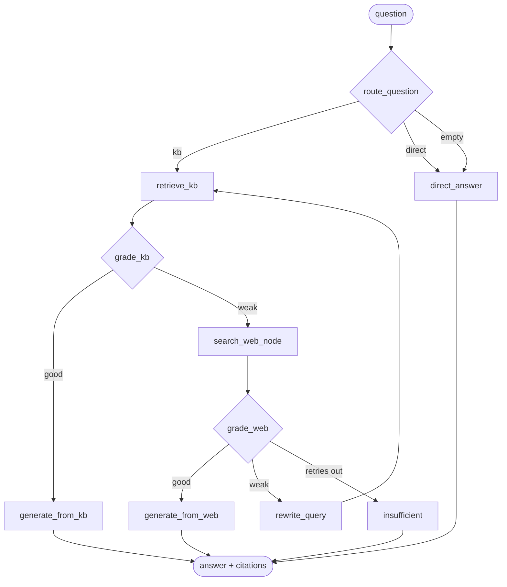

# module-fahim workflow (graph)

## Nodes

| Node | Purpose |
|------|---------|
| `route_question` | LLM JSON decision: `kb` or `direct` |
| `retrieve_kb` | top-k private KB chunks |
| `grade_kb` | evidence strong enough to answer? |
| `search_web_node` | Tavily fallback when KB is weak |
| `grade_web` | web evidence strong enough? |
| `rewrite_query` | new retrieval round, bumps `retry_count` |
| `generate_from_kb` / `generate_from_web` | grounded answers |
| `direct_answer` / `insufficient` | no-retrieval paths |

`retry_count` vs `settings.max_retries` guards the rewrite loop.